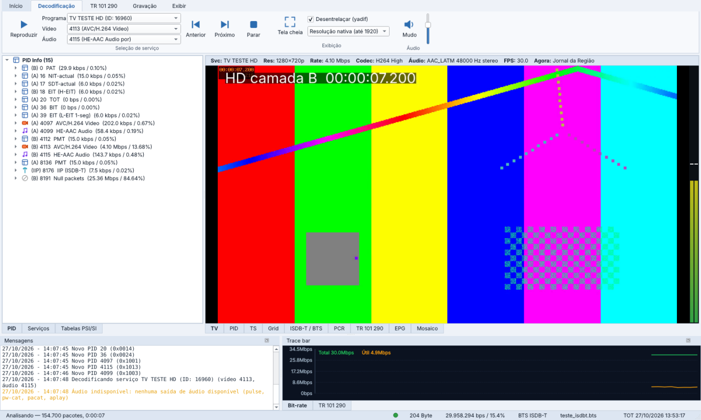
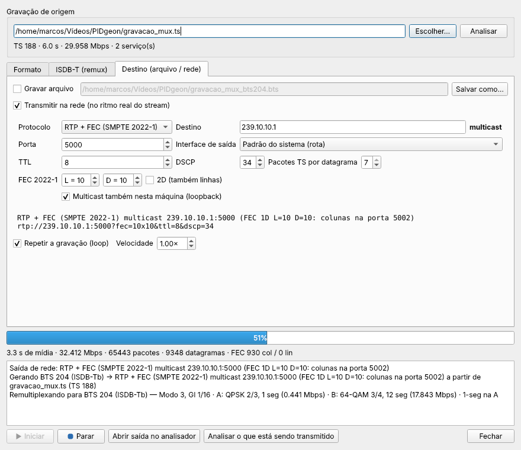
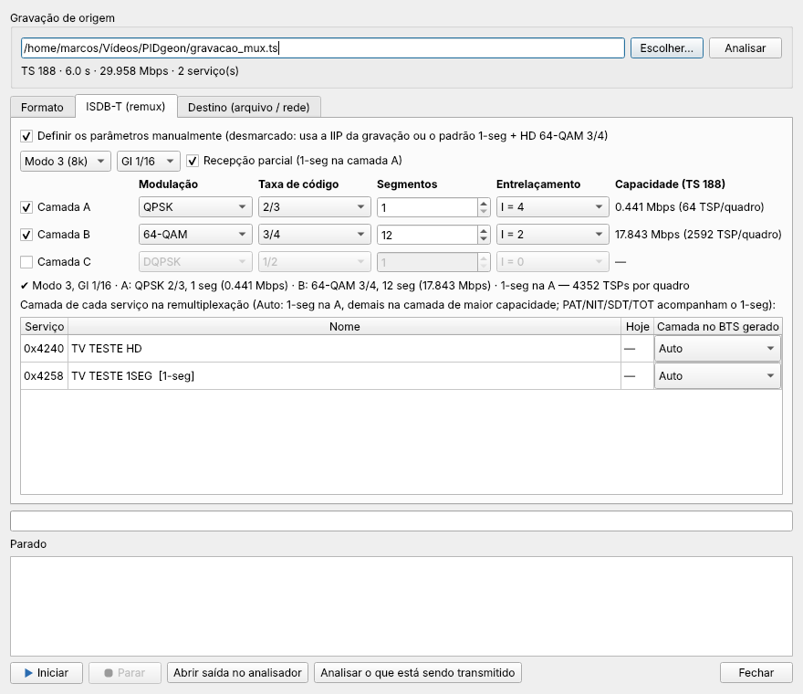
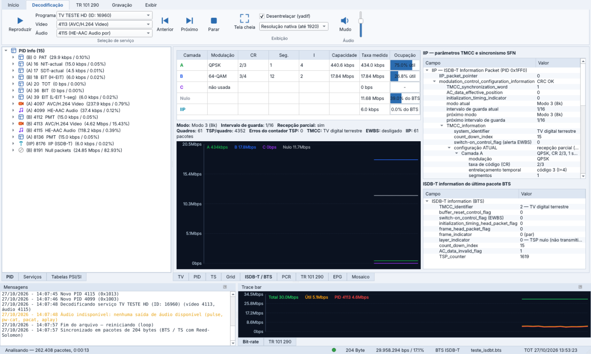
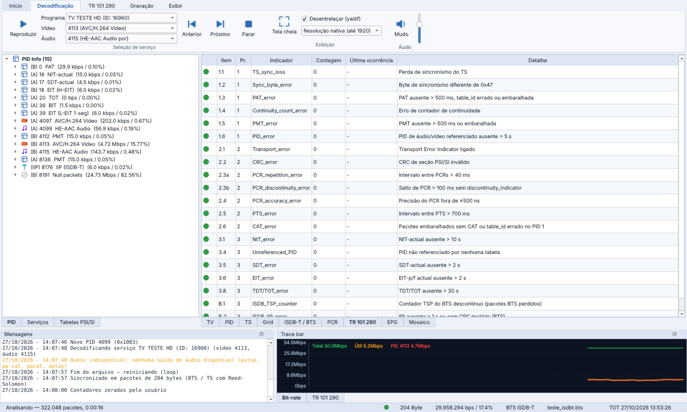
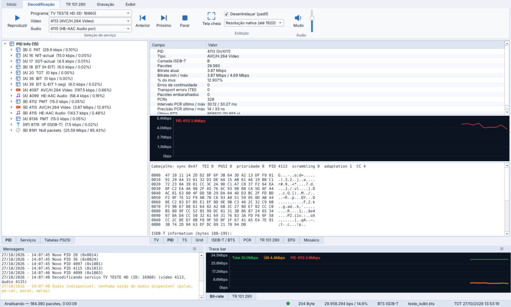
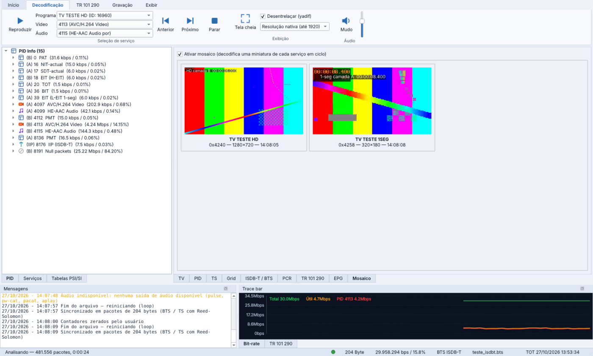
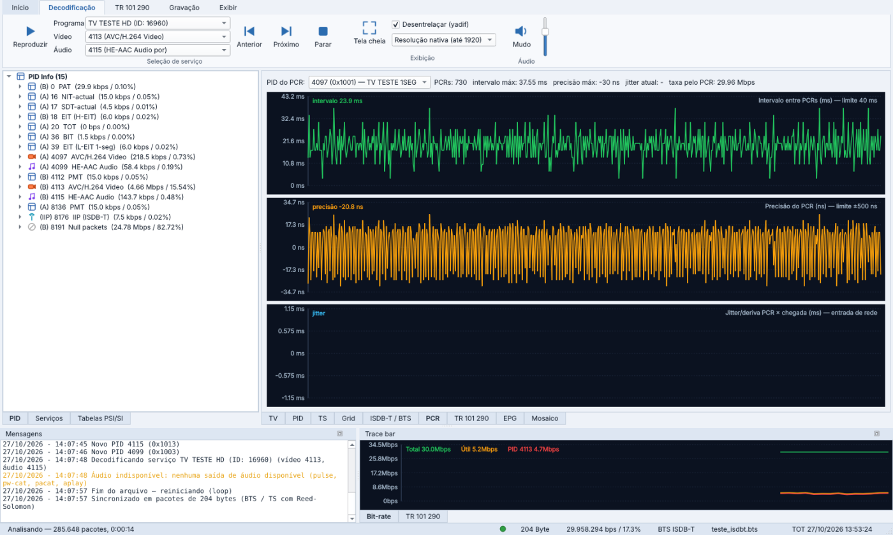
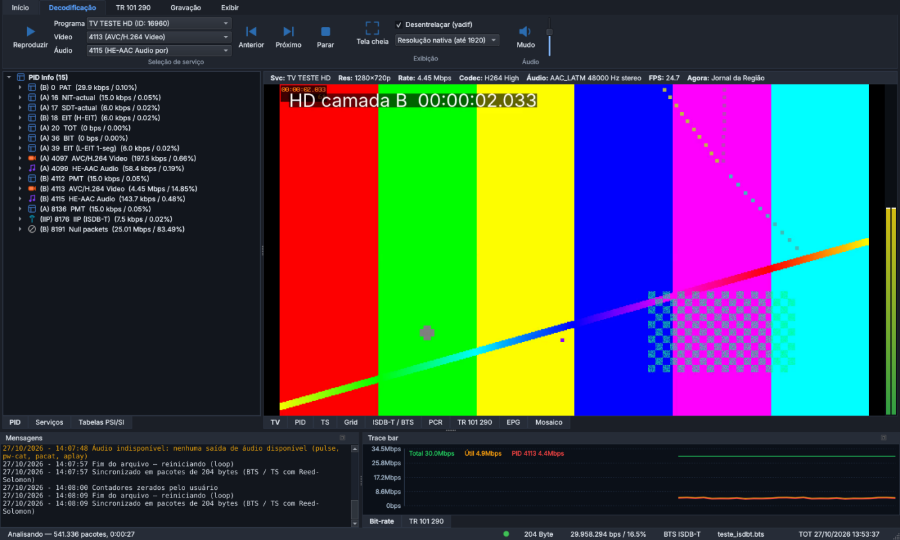

<p align="center">
  
</p>

<h1 align="center">PIDgeon</h1>

<p align="center">
  <b>Analisador e gerador de MPEG Transport Stream e ISDB-Tb para Linux</b><br>
  TS 188 · BTS 204 · UDP/RTP multicast e unicast · PSI/SI · TR 101 290 · camadas ISDB-T e IIP · vídeo ao vivo · gravação<br>
  geração de BTS 204 / BTS 188 / TS 188 / TS 204 · UDP puro, RTP e RTP + FEC SMPTE 2022-1
</p>

<p align="center">
  
</p>

O PIDgeon é um analisador de Transport Stream feito para o dia a dia de quem opera radiodifusão
digital: abre o BTS que sai do multiplexador ISDB-T, o TS que chega por IP no abrigo ou um arquivo
gravado, mostra **cada PID com a camada (A/B/C) onde é transmitido**, decodifica todas as tabelas,
monitora a TR 101 290, toca o vídeo ao vivo e grava o que você precisar - tudo de forma nativa no Linux.
A partir de uma gravação, também **gera BTS 204, BTS 188, TS 188 ou TS 204** e transmite por
**UDP puro, RTP ou RTP + FEC** para um IP unicast ou grupo multicast - um gerador de sinal de
bancada para testar modulador, receptor IRD, enlace e rede IP.

A interface segue o fluxo de trabalho de ferramentas consagradas como TS Reader e StreamXpert
(lista de PIDs à esquerda, vídeo ao centro, mensagens e *trace bar* embaixo), com o que faltava
para o ISDB-Tb brasileiro.

## Destaques

| | |
|---|---|
| **Entradas** | Arquivo (`.ts`, `.trp`, `.bts`, `.m2ts`), **UDP e RTP** (detecção automática), **multicast** com IGMP join, **SSM** (fonte específica), **unicast**, HTTP e stdin |
| **Rede** | Lista de adaptadores ao vivo; **automático que acompanha a troca de placa, cabo e IP**; adaptador fixo que volta sozinho; **diagnóstico** (IGMP, tráfego por placa, rp_filter, firewall) sem precisar de root |
| **Formatos** | **TS 188**, **BTS / TS com Reed-Solomon 204** e **M2TS 192** - tamanho detectado sozinho, com ressincronismo |
| **PIDs** | Bitrate e % do mux, mín./máx., CC, TEI, embaralhamento, PCR, PTS, camada ISDB-T, serviço dono, último pacote em hexadecimal |
| **Tabelas** | PAT, CAT, PMT, NIT, SDT, EIT (H-EIT, M-EIT, **L-EIT 1-seg**), TDT/TOT, BIT, SDTT, CDT, AIT (Ginga), DSM-CC - com todos os descritores MPEG, DVB e **ABNT NBR 15603** |
| **ISDB-T / BTS** | Camada de cada pacote (A/B/C/nulo/IIP), bitrate e ocupação por camada, contador TSP, quadros de multiplexação, flag **EWBS**, **IIP** com parâmetros TMCC atuais e próximos (modulação, CR, entrelaçamento, segmentos, modo, intervalo de guarda), capacidade teórica por camada e **sincronismo de rede SFN** |
| **TR 101 290** | Prioridades 1, 2 e 3 + verificações ISDB-T (contador TSP, IIP), com lâmpadas, contadores e exportação CSV |
| **PCR** | Intervalo, precisão (ns) e jitter/deriva em relação à chegada pela rede |
| **Vídeo ao vivo** | Player embutido (FFmpeg): H.264, HEVC, MPEG-2, AAC / HE-AAC LATM, **1-seg**, desentrelaçamento, medidor de áudio, tela cheia e **mosaico** com todos os serviços |
| **Gravação** | Mux completo no formato original (BTS 204 continua BTS 204) ou convertido para TS 188, **serviço com as tabelas** (PAT reescrita, PMT, SI, PCR - abre em qualquer player) ou PID; divisão por tempo/tamanho |
| **Geração** | A partir de uma gravação: **BTS 204**, **BTS 188**, **TS 188** e **TS 204** (Reed-Solomon RS(204,188)). TS → BTS com **remultiplexação ISDB-Tb**: quadro de multiplexação, camadas A/B/C, IIP, nulos e PCR regenerado; parâmetros da IIP da gravação ou definidos à mão; aviso de capacidade por camada; extração de camadas (ex.: só o 1-seg) |
| **Transmissão** | **UDP puro**, **RTP** e **RTP + FEC SMPTE 2022-1** (1D/2D, L×D configurável), **unicast ou multicast**, interface de saída, TTL, DSCP, pacotes por datagrama, loop e ritmo real pelo PCR |
| **FEC na recepção** | Entrada `rtp://…?fec=on`: recupera datagramas perdidos com o FEC de coluna/linha (2D iterativo) |
| **Extras** | EPG com gênero e classificação indicativa, relatório JSON, modo linha de comando, gerador de BTS ISDB-Tb de teste, detecção de TS 204 com verificação da paridade RS |

## Instalação (Zorin OS, Ubuntu, Debian, Mint, Pop!_OS)

Os dois pacotes da página de **Releases** são **autocontidos**: trazem o Qt, o FFmpeg (PyAV) e as
bibliotecas X11 que costumam faltar numa instalação nova. **Nada é baixado na instalação** - dá para
instalar numa máquina sem internet.

### Pacote .deb (recomendado)

Baixe `pidgeon_1.2.0_amd64.deb` na página de **Releases** e instale com um duplo clique ou:

```bash
sudo apt install ./pidgeon_1.2.0_amd64.deb      # ou: sudo dpkg -i pidgeon_1.2.0_amd64.deb
```

O pacote só depende do que já vem em qualquer desktop Linux (Python 3, Mesa/OpenGL, X11,
fontconfig, GLib). As bibliotecas `libxcb-cursor0`, `libxcb-icccm4`, `libxcb-image0`,
`libxcb-keysyms1`, `libxcb-render-util0`, `libxcb-util1` e `libxkbcommon-x11-0` vão dentro do
pacote e só são usadas se o sistema não as tiver. O PIDgeon fica em `/opt/pidgeon`, com atalho no
menu e os comandos `pidgeon`, `pidgeon-cli`, `pidgeon-gerar`, `pidgeon-enviar` e
`pidgeon-gerar-teste`. Funciona com o Python do sistema (3.10 no Zorin OS 17 / Ubuntu 22.04,
3.12 no Zorin OS 18 / Ubuntu 24.04). Para remover: `sudo apt remove pidgeon`.

### Pacote completo - offline, sem sudo

1. Baixe `PIDgeon-1.2.0-linux-x86_64.zip` na página de **Releases**.
2. Extraia, abra um terminal na pasta e rode:

```bash
./install.sh
```

Pronto: o PIDgeon aparece no menu de aplicativos e o comando `pidgeon` fica disponível.
O pacote já traz o Qt, o FFmpeg (via PyAV) e as bibliotecas X11 que costumam faltar
(`libxcb-cursor0` etc.), então **não precisa de internet nem de senha de administrador**.

Requisitos: Linux x86_64 com Python 3.10+ e glibc 2.34+ - Zorin OS 17/18, Ubuntu 22.04/24.04,
Debian 12/13, Linux Mint 21/22.

Para remover: `./uninstall.sh` (ou `./uninstall.sh --tudo` para apagar também as configurações).

### A partir do código-fonte

```bash
git clone https://github.com/aragonxpd154/PIDgeon.git
cd PIDgeon
./install.sh            # baixa as dependências pelo pip
# ou, para desenvolvimento:
python3 -m venv .venv && . .venv/bin/activate
pip install -r requirements.txt
python -m pidgeon
```

## Uso

```bash
pidgeon                                       # interface gráfica
pidgeon gravacao.bts                          # abre um arquivo
pidgeon udp://239.1.1.1:1234                  # multicast - UDP ou RTP detectado sozinho
pidgeon "rtp://10.10.0.5@232.1.1.1:5000?iface=enp3s0"   # SSM num adaptador específico
pidgeon udp://0.0.0.0:5000                    # unicast em todos os adaptadores
pidgeon-cli --interfaces                      # adaptadores de rede e o que o automático usaria
pidgeon-cli --diagnostico udp://239.1.1.1:1234   # por que o fluxo não chega?
```

Endereços aceitos: `udp://grupo:porta`, `udp://@grupo:porta` (estilo VLC), `rtp://…`,
`udp://fonte@grupo:porta` (SSM), parâmetros `?iface=` (nome do adaptador), `&buffer=` (MB),
`&rtp=off|on` e `&fec=on`, `http://…` e `-` (stdin).

### Adaptador de rede

Na janela **Rede** (e na de geração) o adaptador é escolhido numa lista que se atualiza sozinha a
cada 2 segundos, mostrando IP, tipo (cabo, cabo USB, Wi-Fi, VLAN, bond, bridge), velocidade e se
está conectado. A escolha é guardada pelo **nome** do adaptador (`enp3s0`, `enx00e04c…`), não pelo
IP, e o IGMP join é feito pelo índice da placa - então continua valendo se o IP mudar.

- **Automático** (padrão): faz o join em todos os adaptadores conectados (um por sub-rede, cabo antes
  de Wi-Fi) e, quando o fluxo chega, **trava no adaptador por onde ele veio**. Se a placa for trocada,
  removida, perder o cabo ou mudar de IP, o PIDgeon refaz o join sozinho, sem reabrir o fluxo -
  inclusive em rede isolada, sem rota padrão.
- **Adaptador fixo**: usa só o escolhido; se ele sumir (ex.: placa USB desplugada), o PIDgeon espera
  e refaz o join quando ele voltar. Quando o cabo volta, o join é refeito para o switch (IGMP
  snooping) reaprender a porta.
- A barra de status mostra o adaptador em uso e a aba **TS** conta os joins refeitos.
- Receber multicast **não precisa de root**. Se o fluxo não chegar, **Início → Diagnóstico** mostra
  os adaptadores, o tráfego que chega em cada um, os grupos IGMP inscritos, o `rp_filter`
  (que descarta multicast vindo de outra sub-rede - com botão para corrigir, pedindo a senha) e se
  há firewall (ufw/firewalld) ativo, com o comando para liberar a porta.

Na interface:

- **Início** - abrir arquivo ou rede, recentes, pausar, tempo real × análise rápida, loop, relatório.
- **Decodificação** - programa, vídeo e áudio (como no StreamXpert), reproduzir, anterior/próximo,
  tela cheia (F11 ou duplo clique), desentrelaçar, volume. Duplo clique num serviço também toca.
- **TR 101 290** - zerar contadores e exportar CSV.
- **Gravação** - mux original, mux em TS 188, serviço com tabelas ou PID; divisão por tempo/tamanho.
- **Exibir** - painéis de mensagens e *trace bar*, tema claro/escuro.

Abas centrais: **TV**, **PID** (detalhes, gráfico e hexadecimal com o trailer ISDB-T),
**TS** (resumo do mux, NIT, TOT, BIT, AIT), **Grid** (serviços × componentes), **ISDB-T / BTS**,
**PCR**, **TR 101 290**, **EPG** e **Mosaico**.

### Gerar e transmitir BTS / TS a partir de uma gravação

Na interface: **Início → Gerar / Tx** (ou **Gravação → Gerar / Tx**). Escolha a gravação, o formato
de saída e o destino - arquivo, rede ou os dois ao mesmo tempo.

| Formato | O que sai |
|---|---|
| **BTS 204** | 188 + 8 bytes de informação ISDB-T (camada, contador TSP, cabeçalho de quadro) + 8 bytes (zeros ou paridade RS(204,196)), 32,507936 Mbps - o que entra no modulador. Se a gravação for TS, o PIDgeon **remultiplexa** |
| **BTS 188** | O mesmo BTS sem os 16 bytes finais: nulos e IIP mantidos, 29,958 Mbps constantes |
| **TS 188** | TS MPEG-2 comum. Vindo de BTS, a IIP vira nulo (taxa constante, PCR exato); opção de remover nulos e de manter só algumas camadas |
| **TS 204** | TS 188 + 16 bytes de paridade **Reed-Solomon RS(204,188)** (padrão DVB/ASI 204) |
| **Original** | Repassa os pacotes como estão (só transmite ou copia) |

Na remultiplexação TS → BTS os parâmetros (modo, intervalo de guarda, modulação, taxa de código,
segmentos e entrelaçamento de cada camada) vêm da **IIP da gravação** ou são definidos à mão; cada
serviço pode ser colocado na camada A, B ou C (o 1-seg vai para a A automaticamente, com PAT, NIT,
SDT e TOT). O PIDgeon calcula o quadro de multiplexação, insere a IIP, completa com nulos, regenera o
PCR pelo relógio do BTS e avisa quando a gravação não cabe na capacidade de uma camada.

Na rede, o destino pode ser **um IP unicast ou um grupo multicast**, com protocolo **UDP puro**,
**RTP** ou **RTP + FEC SMPTE 2022-1** (colunas na porta+2 e, no modo 2D, linhas na porta+4),
interface de saída, TTL, DSCP e pacotes TS por datagrama. O envio segue o PCR, em tempo real.

| Origem → destino | Remultiplexação ISDB-T |
|---|---|
|  |  |

### Linha de comando

```bash
pidgeon-cli gravacao.bts                      # resumo completo no terminal
pidgeon-cli udp://239.1.1.1:1234 -s 30 -j relatorio.json   # 30 s de rede + JSON
pidgeon-cli "rtp://239.1.1.1:5000?fec=on"     # recebe RTP recuperando perdas com FEC 2022-1
pidgeon-gerar-teste ~/teste.bts --segundos 20 # BTS ISDB-Tb sintético (HD camada B + 1-seg camada A)

# pidgeon-gerar: gravação -> BTS 204 / BTS 188 / TS 188 / TS 204, em arquivo e/ou na rede
pidgeon-gerar gravacao.bts --analisar                          # mostra formato, serviços, IIP e camadas
pidgeon-gerar gravacao.bts -f ts188 -o saida.ts                # BTS -> TS 188
pidgeon-gerar gravacao.bts -f ts204 -o saida.ts204             # BTS -> TS 204 com Reed-Solomon
pidgeon-gerar gravacao.ts  -f bts204 -o saida.bts              # TS -> BTS (remux, IIP automática)
pidgeon-gerar gravacao.bts -f bts204 -d udp://239.1.1.1:1234 --iface enp3s0 --ttl 8 --loop
pidgeon-gerar gravacao.bts -f ts188  -d "rtp://10.0.0.20:5000?fec=10x10"   # unicast, RTP + FEC 1D
pidgeon-gerar gravacao.ts  -f bts188 -d rtp://239.2.2.2:5000 --fec 20x5 --fec-2d --dscp 34
pidgeon-gerar gravacao.bts -f ts188  --camadas A --remover-nulos -o oneseg.ts   # só o 1-seg
pidgeon-gerar gravacao.ts  -f bts204 --modo 3 --gi 1/16 --camada-a qpsk,2/3,1,4 \
              --camada-b 64qam,3/4,12,2 --servico-camada 0x4240=B -o saida.bts
pidgeon-enviar ~/teste.bts 239.1.1.1:1234 --rtp --loop   # transmite o arquivo como está
```

## Capturas

| ISDB-T / BTS - camadas, IIP e SFN | TR 101 290 |
|---|---|
|  |  |
| **PID - detalhes, bitrate e hexadecimal** | **Mosaico de serviços** |
|  |  |
| **PCR - intervalo, precisão e jitter** | **Tema escuro** |
|  |  |

## Como funciona

```
 entrada ──► Framer ──► Analyzer ──────────────► interface (Qt, atualiza a cada 500 ms)
 (arquivo,   (188/204/   │ PIDs, CC, PCR, PTS
  UDP/RTP,    192, sync) │ seções PSI/SI ► tabelas + descritores
  RTP+FEC,               │ BTS: trailer ISDB-T, IIP, camadas · TS 204: paridade RS
  HTTP)                  │ TR 101 290
                         └► consumidores ("taps"): gravação · filtro de serviço ► FFmpeg (player) · mosaico

 gravação ──► sondagem ──► tempo de cada pacote ──► conversão ─────────────► arquivo
              (formato,    (posição no BTS ou      BTS 204/188 · TS 188/204   │
               IIP, PCR,    interpolação do PCR)   remux TS→BTS (quadro,      └► UDP / RTP / RTP + FEC
               camadas)                            camadas, IIP, PCR)            unicast ou multicast
```

- `pidgeon/core` - análise pura em Python, sem dependência de interface (usada pela GUI e pela CLI);
  `convert.py`, `remux.py`, `rs.py`, `fec.py` e `netout.py` formam o gerador/transmissor.
- `pidgeon/player` - decodificação com PyAV (FFmpeg) e saída de áudio por PulseAudio/PipeWire.
- `pidgeon/gui` - interface PySide6.
- `pidgeon/tools` - `pidgeon-gerar` (conversão e transmissão), gerador de streams de teste e `pidgeon-enviar`.

Arquivos são medidos pelo relógio do próprio stream (PCR), então as taxas são exatas mesmo em
análise rápida; entradas de rede usam o horário de chegada, o que permite medir o jitter.

## Testes

```bash
pip install pytest
python -m pytest -q
```

Os testes geram um BTS ISDB-Tb e um TS 188 com erros injetados e verificam sincronismo,
tabelas, camadas, IIP, TR 101 290, gravação e recepção UDP/RTP. Na geração, cada formato de
saída é reanalisado pelo próprio PIDgeon (TR 101 290 zerada), o Reed-Solomon é conferido contra um
codificador de referência e pelas síndromes, e a transmissão RTP + FEC é testada com perda de
datagramas simulada (todas recuperadas).

### Pacotes

```bash
bash scripts/build_deb.sh       # dist/pidgeon_<versão>_amd64.deb (autocontido)
bash scripts/build_release.sh   # dist/PIDgeon-<versão>-linux-x86_64.zip (offline, sem sudo)
```

Ao criar uma tag `v*` no GitHub, o CI roda os testes, monta o `.deb` e o `.zip`, instala o `.deb`
no Ubuntu 22.04 e 24.04 e publica a release com os dois pacotes.

## Roteiro

- Decodificação de legendas ISDB (closed caption ARIB/ABNT) e do carrossel Ginga.
- Alarmes por e-mail/SNMP e integração com painéis de monitoração.
- Gateway ao vivo: converter e retransmitir uma entrada de rede (UDP/RTP → BTS/TS) sem gravar.
- IPv6 multicast (MLD).
- Saída e entrada SRT.
- Entrada SRT e placas DVB/ISDB-T via Linux DVB API.

## Licença

GPL-3.0 © Marcos Santos. Os pacotes de release incluem PySide6/Qt (LGPLv3), PyAV/FFmpeg e
(no .zip) bibliotecas xcb-util, cada um com sua própria licença.
