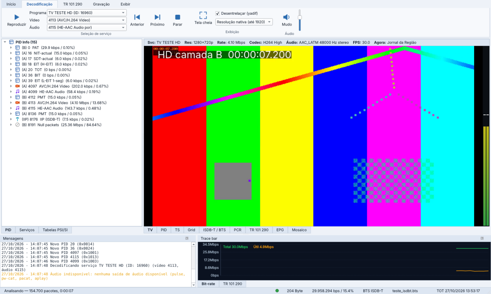
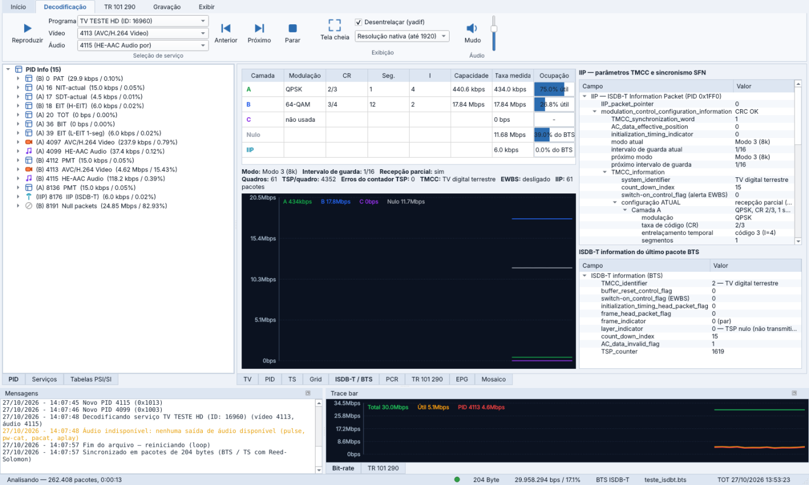
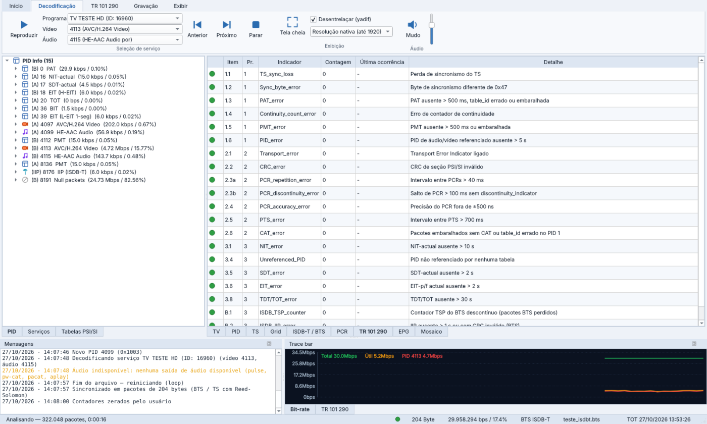
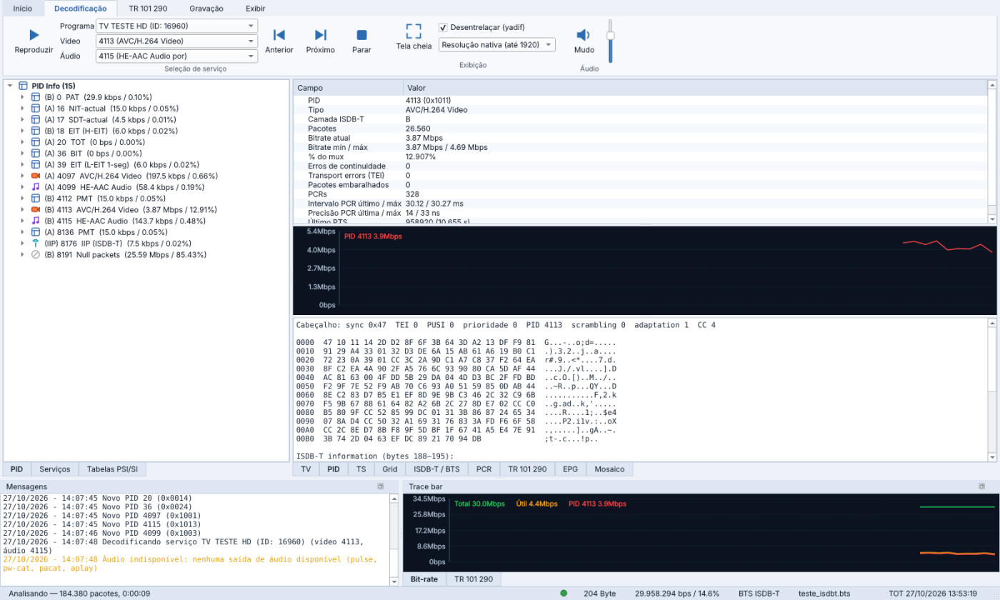
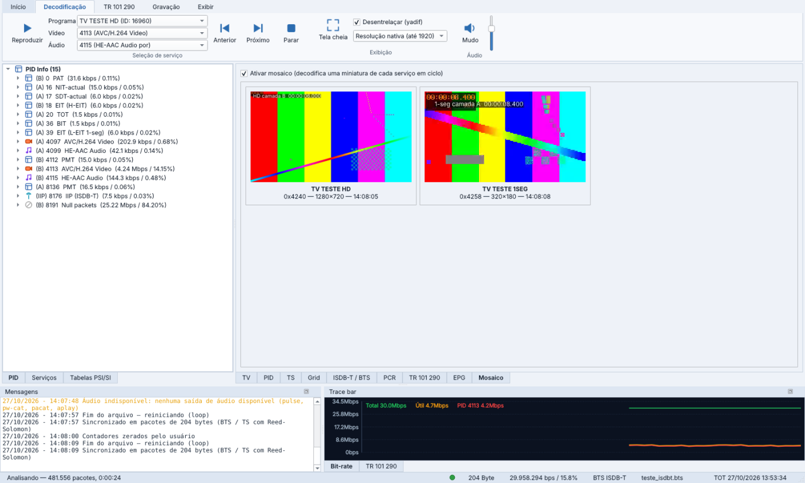
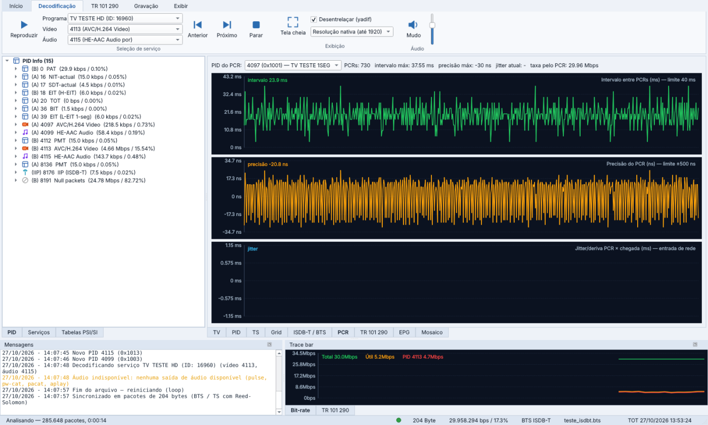
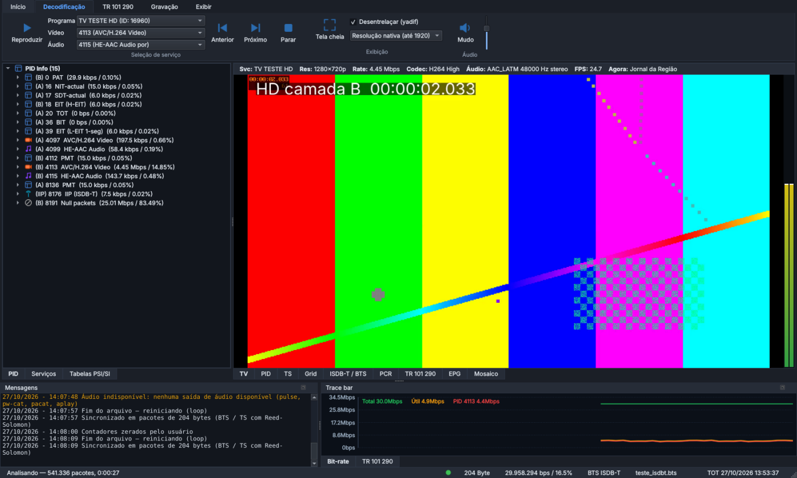

<p align="center">
  
</p>

<h1 align="center">PIDgeon</h1>

<p align="center">
  <b>Analisador de MPEG Transport Stream e ISDB-Tb para Linux</b><br>
  TS 188 · BTS 204 · UDP/RTP multicast e unicast · PSI/SI · TR 101 290 · camadas ISDB-T e IIP · vídeo ao vivo · gravação
</p>

<p align="center">
  
</p>

O PIDgeon é um analisador de Transport Stream feito para o dia a dia de quem opera radiodifusão
digital: abre o BTS que sai do multiplexador ISDB-T, o TS que chega por IP no abrigo ou um arquivo
gravado, mostra **cada PID com a camada (A/B/C) onde é transmitido**, decodifica todas as tabelas,
monitora a TR 101 290, toca o vídeo ao vivo e grava o que você precisar — tudo de forma nativa no Linux.

A interface segue o fluxo de trabalho de ferramentas consagradas como TS Reader e StreamXpert
(lista de PIDs à esquerda, vídeo ao centro, mensagens e *trace bar* embaixo), com o que faltava
para o ISDB-Tb brasileiro.

## Destaques

| | |
|---|---|
| **Entradas** | Arquivo (`.ts`, `.trp`, `.bts`, `.m2ts`), **UDP e RTP** (detecção automática), **multicast** com IGMP join, **SSM** (fonte específica), escolha da **interface de rede**, **unicast**, HTTP e stdin |
| **Formatos** | **TS 188**, **BTS / TS com Reed-Solomon 204** e **M2TS 192** — tamanho detectado sozinho, com ressincronismo |
| **PIDs** | Bitrate e % do mux, mín./máx., CC, TEI, embaralhamento, PCR, PTS, camada ISDB-T, serviço dono, último pacote em hexadecimal |
| **Tabelas** | PAT, CAT, PMT, NIT, SDT, EIT (H-EIT, M-EIT, **L-EIT 1-seg**), TDT/TOT, BIT, SDTT, CDT, AIT (Ginga), DSM-CC — com todos os descritores MPEG, DVB e **ABNT NBR 15603** |
| **ISDB-T / BTS** | Camada de cada pacote (A/B/C/nulo/IIP), bitrate e ocupação por camada, contador TSP, quadros de multiplexação, flag **EWBS**, **IIP** com parâmetros TMCC atuais e próximos (modulação, CR, entrelaçamento, segmentos, modo, intervalo de guarda), capacidade teórica por camada e **sincronismo de rede SFN** |
| **TR 101 290** | Prioridades 1, 2 e 3 + verificações ISDB-T (contador TSP, IIP), com lâmpadas, contadores e exportação CSV |
| **PCR** | Intervalo, precisão (ns) e jitter/deriva em relação à chegada pela rede |
| **Vídeo ao vivo** | Player embutido (FFmpeg): H.264, HEVC, MPEG-2, AAC / HE-AAC LATM, **1-seg**, desentrelaçamento, medidor de áudio, tela cheia e **mosaico** com todos os serviços |
| **Gravação** | Mux completo no formato original (BTS 204 continua BTS 204) ou convertido para TS 188, **serviço com as tabelas** (PAT reescrita, PMT, SI, PCR — abre em qualquer player) ou PID; divisão por tempo/tamanho |
| **Extras** | EPG com gênero e classificação indicativa, relatório JSON, modo linha de comando, gerador de BTS ISDB-Tb de teste e transmissor UDP/RTP |

## Instalação (Zorin OS, Ubuntu, Debian, Mint, Pop!_OS)

### Pacote completo — offline, sem sudo

1. Baixe `PIDgeon-1.0.0-linux-x86_64.zip` na página de **Releases**.
2. Extraia, abra um terminal na pasta e rode:

```bash
./install.sh
```

Pronto: o PIDgeon aparece no menu de aplicativos e o comando `pidgeon` fica disponível.
O pacote já traz o Qt, o FFmpeg (via PyAV) e as bibliotecas X11 que costumam faltar
(`libxcb-cursor0` etc.), então **não precisa de internet nem de senha de administrador**.

Requisitos: Linux x86_64 com Python 3.10+ e glibc 2.34+ — Zorin OS 17/18, Ubuntu 22.04/24.04,
Debian 12/13, Linux Mint 21/22.

Para remover: `./uninstall.sh` (ou `./uninstall.sh --tudo` para apagar também as configurações).

### A partir do código-fonte

```bash
git clone https://github.com/aragonxpd154/PIDgeon.git
cd PIDgeon
./install.sh            # baixa as dependências pelo pip
# ou, para desenvolvimento:
python3 -m venv .venv && . .venv/bin/activate
pip install -r requirements.txt
python -m pidgeon
```

## Uso

```bash
pidgeon                                       # interface gráfica
pidgeon gravacao.bts                          # abre um arquivo
pidgeon udp://239.1.1.1:1234                  # multicast — UDP ou RTP detectado sozinho
pidgeon "rtp://10.10.0.5@232.1.1.1:5000?iface=enp3s0"   # SSM numa interface específica
pidgeon udp://0.0.0.0:5000                    # unicast em todas as interfaces
```

Endereços aceitos: `udp://grupo:porta`, `udp://@grupo:porta` (estilo VLC), `rtp://…`,
`udp://fonte@grupo:porta` (SSM), parâmetros `?iface=` (nome ou IP), `&buffer=` (MB) e
`&rtp=off|on`, `http://…` e `-` (stdin).

Na interface:

- **Início** — abrir arquivo ou rede, recentes, pausar, tempo real × análise rápida, loop, relatório.
- **Decodificação** — programa, vídeo e áudio (como no StreamXpert), reproduzir, anterior/próximo,
  tela cheia (F11 ou duplo clique), desentrelaçar, volume. Duplo clique num serviço também toca.
- **TR 101 290** — zerar contadores e exportar CSV.
- **Gravação** — mux original, mux em TS 188, serviço com tabelas ou PID; divisão por tempo/tamanho.
- **Exibir** — painéis de mensagens e *trace bar*, tema claro/escuro.

Abas centrais: **TV**, **PID** (detalhes, gráfico e hexadecimal com o trailer ISDB-T),
**TS** (resumo do mux, NIT, TOT, BIT, AIT), **Grid** (serviços × componentes), **ISDB-T / BTS**,
**PCR**, **TR 101 290**, **EPG** e **Mosaico**.

### Linha de comando

```bash
pidgeon-cli gravacao.bts                      # resumo completo no terminal
pidgeon-cli udp://239.1.1.1:1234 -s 30 -j relatorio.json   # 30 s de rede + JSON
pidgeon-gerar-teste ~/teste.bts --segundos 20 # BTS ISDB-Tb sintético (HD camada B + 1-seg camada A)
pidgeon-enviar ~/teste.bts 239.1.1.1:1234 --rtp --loop   # transmite um arquivo por UDP/RTP
```

## Capturas

| ISDB-T / BTS — camadas, IIP e SFN | TR 101 290 |
|---|---|
|  |  |
| **PID — detalhes, bitrate e hexadecimal** | **Mosaico de serviços** |
|  |  |
| **PCR — intervalo, precisão e jitter** | **Tema escuro** |
|  |  |

## Como funciona

```
 entrada ──► Framer ──► Analyzer ──────────────► interface (Qt, atualiza a cada 500 ms)
 (arquivo,   (188/204/   │ PIDs, CC, PCR, PTS
  UDP/RTP,    192, sync) │ seções PSI/SI ► tabelas + descritores
  HTTP)                  │ BTS: trailer ISDB-T, IIP, camadas
                         │ TR 101 290
                         └► consumidores ("taps"): gravação · filtro de serviço ► FFmpeg (player) · mosaico
```

- `pidgeon/core` — análise pura em Python, sem dependência de interface (usada pela GUI e pela CLI).
- `pidgeon/player` — decodificação com PyAV (FFmpeg) e saída de áudio por PulseAudio/PipeWire.
- `pidgeon/gui` — interface PySide6.
- `pidgeon/tools` — gerador de streams de teste e transmissor UDP/RTP.

Arquivos são medidos pelo relógio do próprio stream (PCR), então as taxas são exatas mesmo em
análise rápida; entradas de rede usam o horário de chegada, o que permite medir o jitter.

## Testes

```bash
pip install pytest
python -m pytest -q
```

Os testes geram um BTS ISDB-Tb e um TS 188 com erros injetados e verificam sincronismo,
tabelas, camadas, IIP, TR 101 290, gravação e recepção UDP/RTP.

## Roteiro

- Decodificação de legendas ISDB (closed caption ARIB/ABNT) e do carrossel Ginga.
- Alarmes por e-mail/SNMP e integração com painéis de monitoração.
- Entrada SRT e placas DVB/ISDB-T via Linux DVB API.

## Licença

GPL-3.0 © Marcos Santos. O pacote de release inclui PySide6/Qt (LGPLv3), PyAV/FFmpeg e
bibliotecas xcb-util, cada um com sua própria licença.
